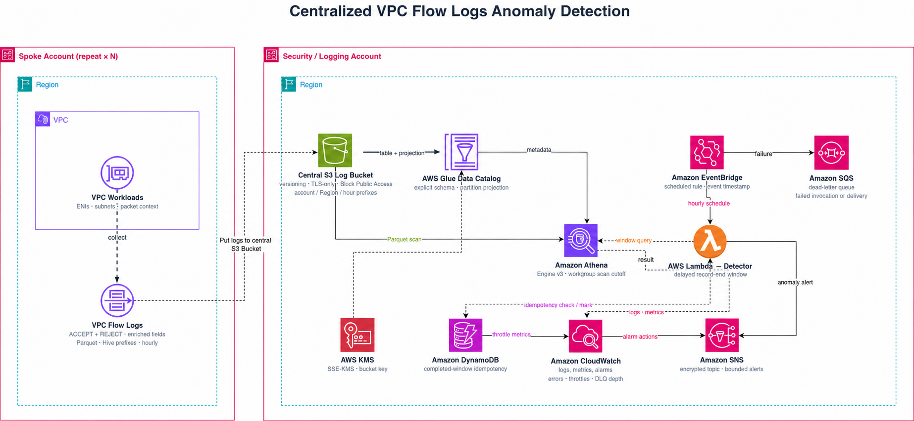

# AWS VPC Flow Logs centralized anomaly detection



[](https://github.com/iamemirozturk/aws-vpc-flowlogs-anomaly-detection/actions/workflows/terraform-ci.yml)
[](https://developer.hashicorp.com/terraform)
[](https://www.python.org/)
[](LICENSE)

This repository is a deployable reference implementation for centralizing VPC
Flow Logs from multiple AWS accounts, querying enriched Parquet records with
Amazon Athena, and alerting on unusually large accepted egress. It demonstrates
security architecture and engineering practice; it is not a managed detection
service or a substitute for threat-specific tuning.

## What is implemented

- Direct cross-account Flow Logs delivery to central S3. S3 delivery does not
  use an IAM delivery role.
- One central Terraform state and one independent state per spoke
  account/Region, with account-ID provider safeguards.
- Enriched Parquet logs, hourly Hive prefixes, and a Glue table with Athena
  partition projection. No crawler or partition-registration job is required.
- A delayed exact rolling-window query that checks accepted egress, uses packet
  addresses when available, handles IPv4/IPv6 exclusions, and totals all
  external destinations per source before applying the threshold.
- One bounded SNS notification per run, DynamoDB window idempotency, reserved
  Lambda concurrency, Lambda handler retries, EventBridge delivery retries, an
  encrypted SQS dead-letter queue, and CloudWatch alarms.
- Customer-managed KMS keys, S3 Block Public Access, TLS-only policies,
  versioning, lifecycle controls, access logging, scoped detector permissions,
  and an Athena scan limit.
- Terraform validation, TFLint, Flake8, unit tests, tfsec, Checkov, Dependabot,
  and pre-commit hooks.

## Detection boundary

The detector identifies volume-based external egress above a static threshold
for each `(account, instance, source IP)` in a configured window. It is a
transparent first-stage analytic, not proof of malicious intent. NAT gateways,
proxies, shared interfaces, approved bulk exports, and delayed or `SKIPDATA`
records affect attribution and completeness.

See the [threat model](docs/threat-model.md) for assumptions and residual risks.

## Repository layout

```text
.
├── athena/queries/                 # Parameterized investigation queries
├── deployments/spoke/             # Separate spoke account/Region root
├── docs/                           # Architecture, threat model, runbook, demo
├── examples/
│   ├── central/                    # Central root variables
│   └── spoke/                      # One spoke deployment variables
├── lambda/
│   ├── detector.py
│   └── tests/
├── modules/
│   ├── central-logging/            # S3, KMS, Glue table, Athena, Lambda IAM
│   ├── detection-engine/           # Lambda, SNS, state, DLQ, alarms
│   └── spoke-account/              # VPC Flow Logs only
├── main.tf                         # Central account root
└── versions.tf
```

## Prerequisites

- Terraform `>= 1.7, < 2.0`
- AWS CLI v2 and short-lived credentials
- Python 3.12 for local tests
- A unique central log bucket name
- A central principal allowed to manage the project resources
- An assumable deployment role in every spoke account with permission to
  describe VPCs and create, update, tag, and delete VPC Flow Logs
- A remote state bucket configured separately from this project

The repository does not create the Terraform backend or cross-account deployment
roles. Those bootstrap resources normally have a different owner and lifecycle.

## Deploy

### 1. Central account

```bash
cp examples/central/terraform.tfvars.example terraform.tfvars
# Edit terraform.tfvars.

# Recommended: copy, edit, and commit backend.tf in a private deployment repo.
cp backend.tf.example backend.tf

export AWS_PROFILE=security-logging
terraform init
terraform plan -out=central.tfplan
terraform apply central.tfplan
terraform output -raw central_log_bucket_arn
```

`log_sources` is both an allowlist and a schema input. Include every spoke
account/Region before creating its Flow Logs. A change updates S3 delivery and
projected partition values.

Object Lock is disabled by default. Enabling it is an irreversible bucket
property; COMPLIANCE retention can prevent even the account owner from deleting
objects. Test governance, recovery, and cost implications first.

If `alert_email` is set, confirm the SNS subscription email before testing.

### 2. One spoke account and Region

```bash
cd deployments/spoke
cp ../../examples/spoke/terraform.tfvars.example terraform.tfvars
# Edit account, Region, role ARN, VPC IDs, and central bucket ARN.

# Use a unique backend key for this account and Region.
cp backend.tf.example backend.tf

export AWS_PROFILE=organization-deployer
terraform init
terraform plan -out=spoke.tfplan
terraform apply spoke.tfplan
```

Repeat with a distinct backend key for each account/Region. Do not use CLI
workspaces or `-target` to simulate account boundaries. The provider assumes
`deployment_role_arn` and refuses to operate in another account.

Flow Logs delivery to S3 is best effort and usually delayed several minutes.
The default 15-minute query delay avoids scanning the newest incomplete period.

## Validate locally

```bash
terraform fmt -check -recursive
terraform init -backend=false
terraform validate
terraform test
terraform -chdir=modules/central-logging init -backend=false
terraform -chdir=modules/central-logging validate
terraform -chdir=modules/central-logging test
terraform -chdir=deployments/spoke init -backend=false
terraform -chdir=deployments/spoke validate
terraform -chdir=deployments/spoke test

tflint --init
tflint --recursive

python3 -m venv .venv
.venv/bin/python -m pip install -r requirements-dev.txt
.venv/bin/python -m pytest
.venv/bin/python -m flake8 lambda
```

CI runs these checks plus tfsec and Checkov without AWS credentials. Provider
lock files are committed for both roots.

## Detector behavior

For an EventBridge event at time `T`:

```text
window_end   = T - data_delay_minutes
window_start = window_end - detection_window_minutes
```

The detector runs at the same whole-minute interval as
`detection_window_minutes`, so adjacent windows neither gap nor overlap. The SQL
enumerates every hourly partition touched and assigns each Flow Log record to the
half-open window containing its `"end"` timestamp. It keeps `ACCEPT`, `egress`,
`OK` records; prefers packet addresses; removes private, loopback, link-local,
carrier-grade NAT, and multicast destinations plus operator exclusions; and
applies the threshold after aggregating every destination for each source.

Flow Log counters describe an aggregation record, not individual packet
timestamps. A record whose aggregation started before the window can therefore
include a bounded amount of earlier traffic, but the record is assigned to only
one adjacent window.

Lambda retries and EventBridge delivery retries retain the event timestamp. A
hash of the window and detector configuration is stored in DynamoDB only after
query and alert success, so completed retries are skipped while a changed
configuration can intentionally re-evaluate a replayed window. A crash after SNS
accepts a message but before the DynamoDB write can still duplicate an alert;
consumers should deduplicate on the window.

## Operations and investigation

- [Architecture](docs/architecture.md)
- [Security controls](docs/security-controls.md)
- [Threat model](docs/threat-model.md)
- [Operational runbook](docs/runbook.md)
- [Demo and evidence guide](docs/demo.md)
- [Cost model](docs/cost-model.md)
- [Upgrade notes](docs/migration-v2.md)
- [GitHub repository settings](docs/repository-settings.md)
- [Athena query templates](athena/queries/)

The detector never changes network policy or isolates a workload.

## Cost and retention

The largest cost drivers are normally vended-log delivery, retained S3 data,
Athena bytes scanned, and KMS requests. Volume and Region matter more than
resource count. Use [Cost model](docs/cost-model.md) with current
[VPC Flow Logs pricing](https://aws.amazon.com/cloudwatch/pricing/),
[S3 pricing](https://aws.amazon.com/s3/pricing/), and
[Athena pricing](https://aws.amazon.com/athena/pricing/); do not rely on a
static monthly estimate.

Destroy spoke Flow Logs before central storage. Central buckets use
`force_destroy = false`. Object-locked objects cannot be removed before
retention permits it.

## Project status

This reference implements deterministic threshold detection. Organization
event-driven onboarding, behavioral baselines, SIEM subscribers, and controlled
integration tests are future extensions, not current capabilities.

See [CONTRIBUTING.md](CONTRIBUTING.md), [SECURITY.md](SECURITY.md), and the
[MIT License](LICENSE). Maintainer:
[Emir Ozturk](https://github.com/iamemirozturk).
